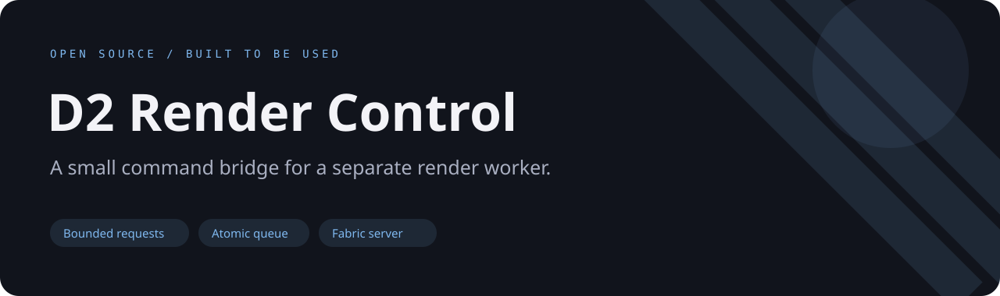
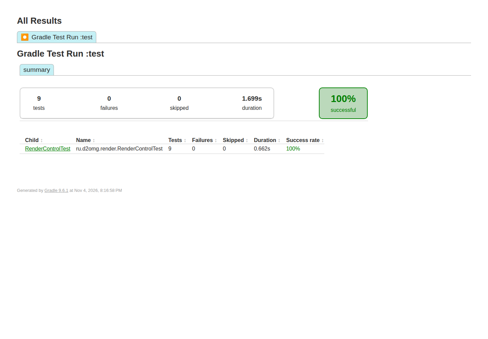

**English** · [Русский](README.ru.md)



# D2 Render Control

A server-side Fabric command bridge that writes bounded render requests to a filesystem queue for an external worker.

[](https://github.com/ari3lYT/d2render-control/actions/workflows/ci.yml)
[](LICENSE)

[Quick start](#quick-start) · [Architecture](docs/architecture.md) · [Development](docs/development.md)


## See it



## What it does

- `/render area`, `/render camera`, `/render video` and `/render here` create validated requests.
- `/render status` shows cached worker progress; `/render cancel ID` writes a cancellation marker.
- Coordinates, camera distance, video duration and queue depth are bounded.
- Queue I/O runs on a dedicated executor; Minecraft does not execute a renderer or shell command.

## Quick start

**Minecraft 26.3 · Fabric Loader 0.19.5+ · Fabric command API · Java 25+**

```bash
./gradlew build
```

Put `build/libs/d2render-control-0.1.2.jar` and the matching Fabric API on a test server. Operators can run:

```text
/render area -32 -32 32 32 80
/render camera 0 100 0 32 70 32
/render video 0 100 0 64 100 0 32 70 32 4
/render status
```

Requests appear under `config/d2gate/render-queue/inbox`. Set a different root with the JVM option
`-Dd2render.queue=/path/to/render-queue`. A separate render worker must consume the queue and
publish results. This repository includes a **mock worker** for validating the protocol, not a renderer:

```bash
python tools/mock_worker.py --queue /path/to/render-queue --once
```

## Integration and development

[Queue protocol](docs/protocol.md) · [Architecture](docs/architecture.md) · [Development](docs/development.md)

```bash
./gradlew test spotbugsMain
python -m unittest discover -s tools -p 'test_*.py' -v
```

The 26.3 build remains an evaluation candidate until a real worker and player session have been
tested together. Passing parser tests or running the mock worker does not demonstrate rendered output.

[Release verification and limits](docs/verification.md) · [Changelog](CHANGELOG.md)
