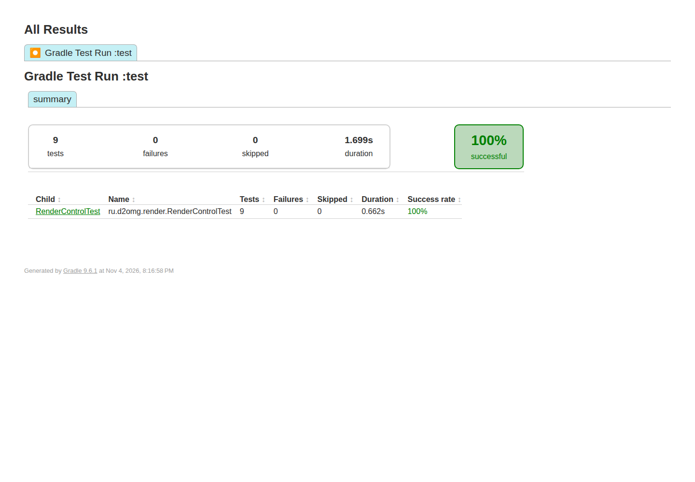

[English](README.md) · **Русский**


# D2 Render Control

Серверный Fabric-мод, который проверяет параметры команд рендера и записывает задания в файловую очередь для отдельного обработчика.

[](https://github.com/ari3lYT/d2render-control/actions/workflows/ci.yml)
[](LICENSE)

[Быстрый старт](#быстрый-старт) · [Архитектура](docs/architecture.ru.md) · [Разработка](docs/development.ru.md)

## Скриншот



## Возможности

- `/render area`, `/render camera`, `/render video` и `/render here` создают проверенные задания.
- `/render status` показывает кэшированный прогресс обработчика; `/render cancel ID` записывает маркер отмены.
- Координаты, расстояние камеры, длительность видео и глубина очереди ограничены.
- Работа с файлами очереди вынесена в отдельный исполнитель; Minecraft не запускает рендерер или команды оболочки.

## Быстрый старт

**Minecraft 26.3 · Fabric Loader 0.19.5+ · Fabric command API · Java 25+**

```bash
./gradlew build
```

Установите `build/libs/d2render-control-0.1.2.jar` и подходящий Fabric API на тестовый сервер. Операторы могут выполнить:

```text
/render area -32 -32 32 32 80
/render camera 0 100 0 32 70 32
/render video 0 100 0 64 100 0 32 70 32 4
/render status
```

Задания появляются в `config/d2gate/render-queue/inbox`. Другой корень задаётся JVM-параметром `-Dd2render.queue=/path/to/render-queue`. Отдельный обработчик должен читать очередь и публиковать результаты. В репозитории есть **тестовый обработчик** для проверки протокола; рендеринг он не выполняет:

```bash
python tools/mock_worker.py --queue /path/to/render-queue --once
```

## Интеграция и разработка

[Протокол очереди](docs/protocol.ru.md) · [Архитектура](docs/architecture.ru.md) · [Разработка](docs/development.ru.md)

```bash
./gradlew test spotbugsMain
python -m unittest discover -s tools -p 'test_*.py' -v
```

Сборка для 26.3 остаётся кандидатом для оценки до совместной проверки настоящего обработчика и игровой сессии. Тесты разбора команд и запуск тестового обработчика не подтверждают получение готового изображения или видео.

[Проверки релиза и их границы](docs/verification.ru.md) · [История изменений](CHANGELOG.ru.md)
