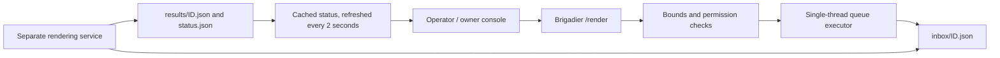

# Architecture

Only overworld player requests can create a render. Status and cancellation do not create a render.
Console sources require owner-level command permission; player sources require OP. Request files
are first written as `.pending`, then atomically renamed. The default queue limit is 20 pending jobs.
Area coordinate span is at most 192 blocks per axis; video duration is an integer from 2 to 8 seconds.
Camera-to-target distance is 2–240 blocks. No external process runs inside the Minecraft JVM.

Treat the queue directory as a trust boundary: only the game service and your render worker should
write it. Worker status/result files are bounded to 32 KiB and must not be symlinks.
