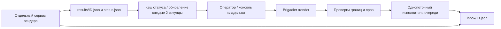

[English](architecture.md) · **Русский**

# Архитектура

Создать задание может только игрок в обычном мире Overworld. Просмотр статуса и отмена не создают рендер. Консоли нужны права команды уровня владельца, игроку — OP. Сначала запрос записывается в `.pending`, затем атомарно переименовывается. Стандартный предел очереди — 20 ожидающих заданий. Размах координат области — до 192 блоков по каждой оси; длительность видео — целое число от 2 до 8 секунд. Расстояние камеры до цели — 2–240 блоков. В JVM Minecraft не запускаются внешние процессы.

Каталог очереди — граница доверия: писать в него должны только игровой сервис и ваш обработчик рендера. Файлы статуса и результата обработчика ограничены 32 КиБ и не должны быть символическими ссылками.
